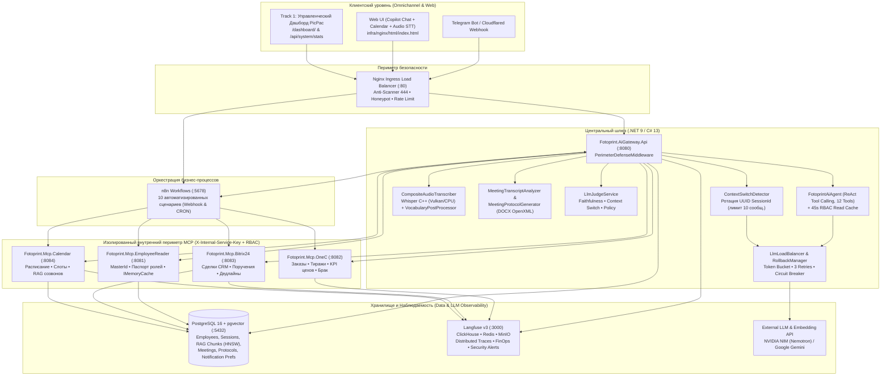
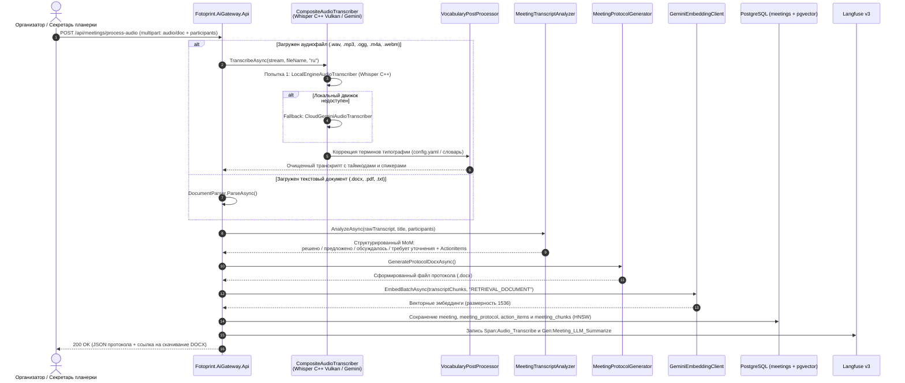
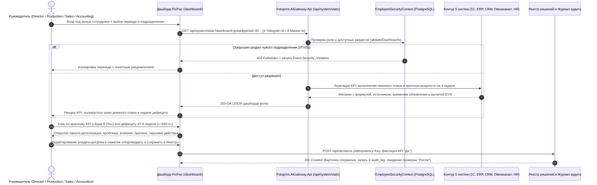

# 📐 ADR-001: Архитектура платформы Fotoprint AI Copilot & Единой системы управления (Track 1 + Track 3)

- **Статус:** Принято (Accepted)
- **Дата актуализации:** 12 ноября 2026
- **Ветка синхронизации:** `dev` (`HEAD: 11eee93`)
- **Заказчик:** ООО «Фотопринт» (`picpac.by`)

---

## 1. Контекст и постановка задачи (Context)

Типография полного цикла ООО «Фотопринт» использует разрозненный ландшафт из **5 операционных контуров**:
1. **CRM / Битрикс24** — клиенты, сделки, коммуникации, поручения и контроль сроков.
2. **Поддержка / Омниканал** — обращения клиентов, тематики, SLA, Telegram/Web-каналы.
3. **ERP / Производство** — заказы, модерация макетов, очередь печати (HP Indigo, Heidelberg, Kolbus), выпуск, брак и доставка.
4. **1С:УНФ / Финансы** — статусы оплат и затрат, индекс исполнения БДР/БДДС, маржинальность.
5. **HR / Персонал** — штатное расписание, смены, вакансии, загрузка и технологические регламенты.

### Ключевые проблемы бизнеса:
- Отсутствие единого управленческого слоя («Пульс компании»), связывающего сигнал отклонения с первопричиной и карточкой решения.
- Высокие трудозатраты руководителей на подготовку к планеркам, протоколирование совещаний (MoM), поиск регламентов и ручную постановку задач.
- Риск утечки закрытых финансовых и кадровых данных между подразделениями при использовании LLM и аналитических витрин.
- Нестабильность внешних LLM/STT-провайдеров при пиковых нагрузках (Rate Limits `HTTP 429`, таймауты сети).

---

## 2. Принятые архитектурные решения (Architectural Decisions)

### ADR-001.1: Изолированный периметр MCP-микросервисов и единый API-шлюз (.NET 9)
- **Решение:** Внешний трафик принимается исключительно через `Nginx Ingress` (с анти-сканер защитой `444 Drop`, honeypot-ловушками и `limit_req`), который проксирует запросы в `Fotoprint.AiGateway.Api` (`:8080`). Доменные коннекторы вынесены в 4 изолированных MCP-сервера (`EmployeeReader :8081`, `OneC :8082`, `Bitrix24 :8083`, `Calendar :8084`) без публичного проброса портов.
- **Обоснование:** Исключает прямой доступ извне к корпоративным системам; все межсервисные вызовы защищены заголовком `X-Internal-Service-Key` и `SecurityInterceptorMiddleware`.

### ADR-001.2: 3-этапный конвейер диалога с LLM-детекцией смены контекста (`ContextSwitchDetector`)
- **Решение:** Перед вызовом оркестратора `n8n` и `FotoprintAiAgent` шлюз загружает до 10 последних незамороженных сообщений активной сессии (`master_id`) и передает их в `IContextSwitchDetector`. При обнаружении смены темы (`is_context_switched = true`) старый `UUID SessionId` закрывается, его сообщения замораживаются (`is_frozen = true`), и создается новый `SessionId`.
- **Обоснование:** Предотвращает «загрязнение» контекста LLM старыми темами и экономит токены при длительных диалогах в Telegram и Web UI.

### ADR-001.3: Zero-Trust RBAC на уровне БД, векторного поиска (pgvector) и дашбордов
- **Решение:** Идентификация сотрудника выполняется по `TelegramId` или `MasterId` с резолвингом паспорта прав (`EmployeeSecurityContext`: роли `Director`, `Production`, `Sales`, `Accounting`, группы доступа `access_groups`).
  - Векторный поиск (`vector(1536)` / HNSW в PostgreSQL) фильтрует чанки регламентов и протоколов строго на уровне SQL (`allowed_access_groups ?| @UserGroups`).
  - При отсутствии права на инструмент или раздел возвращается `403 Forbidden`, а в Langfuse v3 пишется событие `Event:Security_Violation`.

### ADR-001.4: Обязательный Human-in-the-Loop (подтверждение мутирующих действий)
- **Решение:** Инструменты с атрибутом `[RequireConfirmation(true)]` (`create_task`, `schedule_meeting`, сохранение карточки решения) никогда не выполняются автоматически при первом проходе LLM. Агент возвращает карточку предпросмотра (`ActionCard` / «План действий»), и только после явного подтверждения пользователем (`POST /api/calendar/confirm` или повторного сообщения «Подтверждаю») выполняется запись в БД/MCP.

### ADR-001.5: Отказоустойчивость (Token Bucket Load Balancer + 3 Retries + Compensating Rollback + Hybrid STT)
- **Решение:**
  - Все вызовы к LLM (NVIDIA NIM / Gemini) проходят через `ILlmLoadBalancer` (контроль RPM и параллелизма) и `IRollbackManager` (3 повтора с экспоненциальным backoff и компенсацией при сбое).
  - Для транскрибации речи (`CompositeAudioTranscriber`) используется гибридный каскад: локальный движок `Whisper C++ (Vulkan GPU / CPU)` с постобработкой словаря терминов типографии (`VocabularyPostProcessor`) и автоматическим переключением на `CloudGeminiAudioTranscriber` при сбое.

---

## 3. Диаграмма компонентов системы (Component Diagram)



---

## 4. Полный каталог возможностей и сценариев использования (Use Cases)

Ниже перечислены **все реализованные сценарии и возможности** платформы в ветке `dev` (включая 12 инструментов ReAct-агента, 10 воркфлоу `n8n`, конвейер совещаний, календарь и управленческий контур).

### 4.1. Инструменты автономного ReAct-агента (`FotoprintAiAgent` — 12 Function Tools)

| Код | Инструмент (Tool) | Целевой сервис / Модуль | Требуемое право RBAC | Подтверждение (HiTL) | Бизнес-сценарий (Use Case) |
|---|---|---|---|---|---|
| **UC-A01** | `get_order_status` | `Fotoprint.Mcp.OneC` | `onec:read_orders` | Нет | Проверка статуса заказа/тиража в 1С (этап печати, % готовности, дата отгрузки, остатки бумаги и краски). |
| **UC-A02** | `get_production_kpis` | `Fotoprint.Mcp.OneC` | `onec:read_production_kpis` | Нет | Получение KPI цехов: выработка оттисков, процент брака, загрузка машин Heidelberg/Indigo, простои. |
| **UC-A03** | `get_user_tasks` | `Fotoprint.Mcp.Bitrix24` | `bitrix24:read_tasks` | Нет | Просмотр активных и просроченных задач/поручений сотрудника из Битрикс24. |
| **UC-A04** | `get_crm_deal_info` | `Fotoprint.Mcp.Bitrix24` | `bitrix24:read_tasks` | Нет | Карточка CRM-сделки по номеру заказа или клиенту (сумма, стадия, статус оплаты, менеджер). |
| **UC-A05** | `create_task` | `Fotoprint.Mcp.Bitrix24` | `bitrix24:create_tasks` | **Да (`RequireConfirmation`)** | Постановка новой задачи в Битрикс24 с дедлайном и ответственным после подтверждения плана действий. |
| **UC-A06** | `find_free_slots` | `Fotoprint.Mcp.Calendar` | `calendar:read_meetings` | Нет | Умный подбор свободных окон в календаре для группы участников (рабочие часы 09:00–18:00, буфер 10 мин). |
| **UC-A07** | `schedule_meeting` | `Fotoprint.Mcp.Calendar` | `calendar:read_meetings` | **Да (`RequireConfirmation`)** | Назначение совещания/планерки в корпоративном календаре после подтверждения карточки предпросмотра. |
| **UC-A08** | `get_upcoming_meetings` | `Fotoprint.Mcp.Calendar` | `calendar:read_meetings` | Нет | Получение списка ближайших встреч, тем и участников за выбранное окно времени. |
| **UC-A09** | `get_meeting_history` | `Fotoprint.Mcp.Calendar` | `calendar:read_meetings` | Нет | Поиск прошлых совещаний, протоколов и поручений по ключевым словам темы. |
| **UC-A10** | `search_meeting_rag` | `AiGateway` / `Mcp.Calendar` | `calendar:read_meetings` + фильтр участника | Нет | Семантический поиск по стенограммам и решениям прошлых созвонов (Google Meet RAG), где сотрудник был участником. |
| **UC-A11** | `search_typography_regulations` | `AiGateway` (`pgvector` RAG) | Фильтр по `access_groups` | Нет | Поиск по техкартам, нормам брака, коммерческой политике, положению о премировании и ПВТР (или обзор всех доступных документов по `*`). |
| **UC-A12** | `get_notification_settings` / `update_notification_settings` | `NotificationEndpoints` | Личный профиль сотрудника | Нет (применяется сразу) | Чтение и голосовое/текстовое изменение настроек уведомлений: время утреннего дайджеста, напоминания о встречах и дедлайнах, тихие часы. |

---

### 4.2. Автоматизированные сценарии оркестратора `n8n` (10 Workflows)

1. **`01_main_router_and_auth.json`** — Единый входной роутер сообщений (Telegram / Web), валидация сотрудника через `EmployeeReader` и маршрутизация по веткам.
2. **`02_rbac_rag_pipeline.json`** — Конвейер векторного поиска по корпоративным документам с жесткой RBAC-фильтрацией.
3. **`03_pre_meeting_prep_cron.json`** — CRON-сбор повестки, статусов проблемных заказов 1С и открытых задач за 15 минут до утренней планерки.
4. **`04_live_meeting_copilot.json`** — Быстрый копайлот во время совещания (мгновенная справка по заказу, клиенту или техкарте).
5. **`05_post_meeting_mom_and_tasks.json`** — Постобработка записи совещания, генерация протокола (MoM) по 4 статусам (`решено`, `предложено`, `обсуждалось`, `требует уточнения`) и постановка задач.
6. **`06_executive_summary.json`** — Генерация управленческой сводки (C-Level Executive Summary) для директора по 5 системам.
7. **`07_google_meet_post_processing.json`** — Полный пайплайн обработки аудио/видео или архива Google Meet: транскрибация, диаризация спикеров, извлечение решений, сохранение и векторная индексация в БД.
8. **`08_meeting_recall_rag_and_export.json`** — Ответы по архиву прошедших созвонов и экспорт полного пакета протокола (`.docx` / JSON).
9. **`09_morning_schedule_digest_cron.json`** — Персональная утренняя сводка расписания и KPI с учетом индивидуального времени доставки и тихих часов сотрудника.
10. **`10_task_deadline_reminders_cron.json`** — Упреждающие уведомления о приближающихся и просроченных дедлайнах поручений.

---

### 4.3. Специализированные мультимодальные и управленческие сценарии (API & UI)

- **UC-M01: Гибридная транскрибация и анализ созвонов (`/api/audio/transcribe`, `/api/meetings/process-audio`)** — прием `.wav/.mp3/.ogg/.m4a/.webm` или готовых транскриптов `.txt/.docx/.pdf`, локальное распознавание Whisper C++ с коррекцией полиграфических терминов (`Heidelberg`, `Kolbus`, `биговка`, `приладка`), извлечение решений и экспорт в Word (`/api/meetings/{id}/export-docx`).
- **UC-M02: Интерактивный корпоративный календарь (`/api/calendar/events`, `/api/calendar/slots`, `/api/calendar/confirm`)** — визуальная сетка расписания в Web UI (режимы «Мои встречи» и «Все встречи компании» для Директора), подбор свободных слотов и stateless-подтверждение встречи в один клик.
- **UC-M03: Автоматический контроль качества ответов LLM (`LLM-as-a-Judge`)** — оценка `Faithfulness` (отсутствие галлюцинаций относительно JSON от 1С/RAG), `Context Switch Accuracy` и `Formatting & Policy Check` с записью метрик в Langfuse.
- **UC-M04: Управленческий дашборд Трека 1 («Пульс компании» и 5 контуров)** — ролевой доступ (`Director`, `Production`, `Sales`, `Accounting`), план на смену с полукруглыми гейджами, прогноз спроса и мощности на 4 недели, детализация красного KPI до причины и сохранение карточки в Реестр решений.

---

## 5. Диаграммы последовательности (Sequence Diagrams)

### 5.1. Диалог с ассистентом, детекция смены контекста, ReAct Tool Calling и подтверждение действия (HiTL)

```mermaid
sequenceDiagram
    autonumber
    actor User as Сотрудник (Web UI / Telegram)
    participant GW as Fotoprint.AiGateway.Api
    participant Repo as PostgreSQL + pgvector
    participant CSD as ContextSwitchDetector
    participant N8N as n8n (01_main_router)
    participant Agent as FotoprintAiAgent
    participantLLM as NVIDIA NIM / Gemini (via LoadBalancer)
    participant MCP as MCP Server (OneC / Bitrix24 / Calendar)
    participant LF as Langfuse v3

    User->>GW: POST /api/agent/chat { telegramId, chatId, message }
    GW->>Repo: GetEmployeeSecurityContextAsync(telegramId)
    Repo-->>GW: EmployeeSecurityContext (MasterId, Roles, AccessGroups)
    GW->>Repo: GetOrCreateActiveSessionByMasterIdAsync(MasterId)
    GW->>Repo: GetMessagesBySessionIdAsync(SessionId, limit: 10)

    GW->>CSD: DetectSwitchAsync(last10Messages, currentMessage)
    CSD->>participantLLM: Классификация смены темы
    participantLLM-->>CSD: { is_context_switched, suggested_branch }
    alt Смена контекста обнаружена (is_context_switched == true)
        GW->>Repo: RotateSessionOnContextSwitchAsync(MasterId)<br/>Заморозка старых сообщений (is_frozen=true) + новый UUID SessionId
    end

    GW->>N8N: Webhook /fotoprint-chat (trace_id, session_id, master_id, branch)
    N8N->>GW: POST /api/agent/execute (X-Internal-Service-Key)
    GW->>Agent: ProcessMessageAsync(telegramId, chatId, message, traceId)

    Agent->>participantLLM: Turn 1: Запрос + 12 деклараций MCP-инструментов
    participantLLM-->>Agent: FunctionCall (напр. get_production_kpis или schedule_meeting)

    alt Вызван read-only инструмент (RequireConfirmation = false)
        Agent->>MCP: Вызов инструмента + X-Telegram-Id + X-Internal-Service-Key
        MCP->>MCP: SecurityInterceptorMiddleware: проверка HasPermission()
        alt Нет прав доступа
            MCP->>LF: LogSecurityAlertAsync (Event:Security_Violation)
            MCP-->>Agent: 403 Forbidden
        else Права подтверждены
            MCP-->>Agent: 200 OK (JSON с фактами из 1С / CRM / RAG)
        end
        Agent->>participantLLM: Turn 2: Синтез ответа по данным инструмента
        participantLLM-->>Agent: Финальный ответ со ссылками на источники
    else Вызван мутирующий инструмент (create_task / schedule_meeting) без подтверждения
        Agent-->>GW: Возврат карточки предпросмотра (ActionCard / План действий)
        GW-->>User: Отображение карточки: [Подтвердить] / [Отмена]
        User->>GW: Нажатие [Подтвердить] (POST /api/calendar/confirm или "Подтверждаю")
        GW->>MCP: Выполнение записи в БД и создание события/задачи
        MCP-->>User: 200 OK (Запись подтверждена и сохранена в аудит)
    end

    Agent->>LF: Запись Trace, Generation (токены, FinOps) и Spans
    GW-->>User: Ответ ассистента + trace_id
```

---

### 5.2. Обработка аудиозаписи совещания, генерация протокола (MoM) и индексация в RAG



---

### 5.3. Сквозной управленческий цикл Трека 1 (Дашборд «Пульс компании» → Разбор причины → Реестр решений)



---

## 6. Последствия и верификация (Consequences & Verification)

### Преимущества архитектуры:
1. **Полная трассируемость и безопасность (Zero Trust):** Ни один запрос к 1С, Битрикс24, Календарю или векторной базе знаний не обходит проверку `EmployeeSecurityContext`.
2. **Бесшовная сшивка Трека 1 и Трека 3:** Дашборд руководителя и AI-ассистент опираются на единую ролевую матрицу сотрудников (`employees`) и правило обязательного подтверждения действий (`Human-in-the-Loop`).
3. **Готовность к оффлайн- и пиковым нагрузкам:** Наличие RBAC-кэша чтения (45 сек), балансировщика `LlmLoadBalancer`, 3 повторов с роллбэком и локального Whisper C++ гарантирует стабильную демонстрацию на защите.

### Ограничения и технический долг (Next Steps):
- Для полного слияния ветки фронтенда (`feature/frontend-rey`) с `dev` бэкенд-команде достаточно расширить эндпоинт `GET /api/system/stats` (или подключить ролевой JSON по контракту `docs/dashboard-contract.md`) и `POST /api/decisions` для серверного хранения карточек решений в PostgreSQL.
