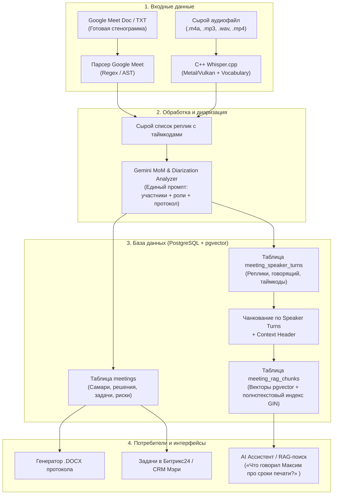

# 01. Общая архитектура пайплайна совещаний

## 1. Введение и цели системы
Система предназначена для автоматического протоколирования (Minutes of Meeting, MoM), атрибуции спикеров (Speaker Diarization) и семантического поиска (RAG) по рабочим совещаниям компании «ООО Фотопринт».

### Ключевые возможности:
1. **Поддержка двух типов входа**:
   * **Текстовые выгрузки Google Meet**: автоматический парсинг готовых стенограмм с именами и таймкодами.
   * **Сырое аудио (.m4a, .mp3, .wav, .mp4)**: транскрибация через локальный C++ Whisper с терминологическим словарем.
2. **Диаризация через Gemini (DiarizationLM)**: привязка фраз к реальным участникам на основе контекста диалога и обращений.
3. **Meeting RAG**: семантический поиск по репликам сотрудников с точностью до секунды.

---

## 2. Схема потоков данных (End-to-End Flow)



---

## 3. Схема базы данных (Relational + Vector Schema)

```sql
-- Расширение для работы с векторами
CREATE EXTENSION IF NOT EXISTS vector;
CREATE EXTENSION IF NOT EXISTS "uuid-ossp";

-- 1. Метаданные встречи и итоговый протокол
CREATE TABLE IF NOT EXISTS meetings (
    id UUID PRIMARY KEY DEFAULT uuid_generate_v4(),
    title VARCHAR(255) NOT NULL,
    meeting_date TIMESTAMPTZ NOT NULL DEFAULT NOW(),
    source_type VARCHAR(50) NOT NULL, -- 'google_meet', 'audio_upload', 'telegram_voice'
    organizer_id INT,
    chat_id BIGINT,
    raw_transcript TEXT NOT NULL,
    summary TEXT NOT NULL,
    decisions JSONB NOT NULL DEFAULT '[]'::jsonb,
    action_items JSONB NOT NULL DEFAULT '[]'::jsonb,
    risks JSONB NOT NULL DEFAULT '[]'::jsonb,
    participants JSONB NOT NULL DEFAULT '[]'::jsonb,
    docx_path VARCHAR(512),
    created_at TIMESTAMPTZ NOT NULL DEFAULT NOW()
);

-- 2. Детализированные реплики спикеров (Speaker Turns)
CREATE TABLE IF NOT EXISTS meeting_speaker_turns (
    id UUID PRIMARY KEY DEFAULT uuid_generate_v4(),
    meeting_id UUID NOT NULL REFERENCES meetings(id) ON DELETE CASCADE,
    speaker_name VARCHAR(120) NOT NULL,
    speaker_role VARCHAR(120),
    start_time_seconds NUMERIC(8, 2) NOT NULL,
    end_time_seconds NUMERIC(8, 2) NOT NULL,
    turn_text TEXT NOT NULL,
    turn_index INT NOT NULL,
    confidence NUMERIC(4, 3) DEFAULT 1.000,
    created_at TIMESTAMPTZ NOT NULL DEFAULT NOW()
);

CREATE INDEX IF NOT EXISTS idx_speaker_turns_meeting_id ON meeting_speaker_turns(meeting_id);
CREATE INDEX IF NOT EXISTS idx_speaker_turns_speaker ON meeting_speaker_turns(speaker_name);

-- 3. Векторные чанки для семантического RAG-поиска
CREATE TABLE IF NOT EXISTS meeting_rag_chunks (
    id UUID PRIMARY KEY DEFAULT uuid_generate_v4(),
    meeting_id UUID NOT NULL REFERENCES meetings(id) ON DELETE CASCADE,
    chunk_index INT NOT NULL,
    start_time_seconds NUMERIC(8, 2) NOT NULL,
    end_time_seconds NUMERIC(8, 2) NOT NULL,
    speakers_list TEXT[] NOT NULL,
    content_with_header TEXT NOT NULL,
    embedding vector(1536), -- 1536 (OpenAI/Gemini Text Embedding)
    created_at TIMESTAMPTZ NOT NULL DEFAULT NOW()
);

-- Индексы для быстрого гибридного поиска
CREATE INDEX IF NOT EXISTS idx_meeting_rag_chunks_meeting_id ON meeting_rag_chunks(meeting_id);
CREATE INDEX IF NOT EXISTS idx_meeting_rag_chunks_hnsw ON meeting_rag_chunks USING hnsw (embedding vector_cosine_ops);
CREATE INDEX IF NOT EXISTS idx_meeting_rag_chunks_gin ON meeting_rag_chunks USING gin (to_tsvector('russian', content_with_header));
```
