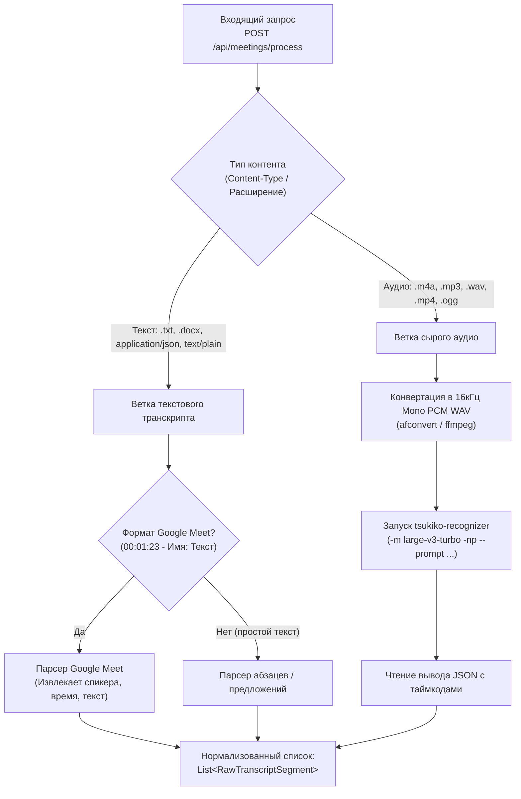

# 02. Фаза 1: Прием данных и транскрибация (Ingestion & Parsing)

## 1. Цель фазы
Обеспечить универсальный вход в систему:
1. Автоматическое распознавание типа входящего контента (готовый текст Google Meet vs сырое аудио).
2. Безошибочная транскрибация аудиофайлов любой длительности через C++ Whisper.cpp с терминологическим словарем без ручной нарезки на диске.
3. Формирование единого нормализованного списка реплик `RawTranscriptSegment` для следующего этапа.

---

## 2. Логика автодетекта входа



---

## 3. Парсер транскрипта Google Meet

Транскрипты Google Meet (выгруженные из Google Docs или REST API) имеют регулярный вид:
```text
00:00:15 - Иван Иванов: Добрый день, коллеги! Начинаем планерку по производству.
00:00:22 - Максим: Привет! Давайте сразу перейдем к загрузке машин Heidelberg.
```

### Регулярное выражение для парсинга:
```csharp
private static readonly Regex GoogleMeetLineRegex = new(
    @"^(?:\[?(?<time>\d{1,2}:\d{2}(?::\d{2})?)\]?\s*[-–—]\s*)?(?<speaker>[^:\n\r]+):\s*(?<text>.+)$",
    RegexOptions.Compiled | RegexOptions.Multiline);
```

Если текст соответствует паттерну — спикер и таймкод извлекаются автоматически со 100% достоверностью.

---

## 4. Пайплайн транскрибации аудиофайлов

### Почему НЕ нужна ручная нарезка на 15 минут:
* Движок C++ `tsukiko-recognizer` (сборка `whisper.cpp`) содержит встроенный потоковый алгоритм скользящего окна.
* Он последовательно обрабатывает аудио по 30-секундным мел-спектрограммам, сдвигая окно вперед по границам предложений.
* При передаче часового созвона (например, 60 минут `.m4a`) движок сам выполняет транскрибацию за один проход на Metal/Vulkan GPU без переполнения оперативной памяти.

### Внедрение терминологического словаря (`--prompt`):
Для предотвращения искажений узкоспециализированных терминов компании «ООО Фотопринт» в аргументы запуска C++ движка передается параметр `--prompt`:
```bash
tsukiko-recognizer \
  -m models/ggml-large-v3-turbo.bin \
  -l ru \
  -np \
  --prompt "ООО Фотопринт, Битрикс24, 1С, CRM Мэри, Heidelberg, флексомашина, приладка, ламинация, УФ-лак, SafeRoute, СДЭК, 5Post, постамат." \
  -oj \
  -of /tmp/output_prefix \
  -f /tmp/input_16k_mono.wav
```

---

## 5. Контракт DTO нормализованного транскрипта

```csharp
namespace Fotoprint.Core.Models.Meetings;

/// <summary>
/// Единая нормализованная реплика транскрипта встречи до анализа.
/// </summary>
public record RawTranscriptSegment(
    int Index,
    string? KnownSpeaker,          // Заполнено, если источник Google Meet, иначе null
    double StartTimeSeconds,
    double EndTimeSeconds,
    string Text
);

/// <summary>
/// Результат фазы 1 для передачи в анализатор MoM.
/// </summary>
public record IngestionResult(
    bool Success,
    string SourceType,             // 'google_meet', 'audio_whisper', 'plain_text'
    string RawFullText,
    List<RawTranscriptSegment> Segments,
    List<string> DetectedParticipants,
    string? ErrorMessage = null
);
```
